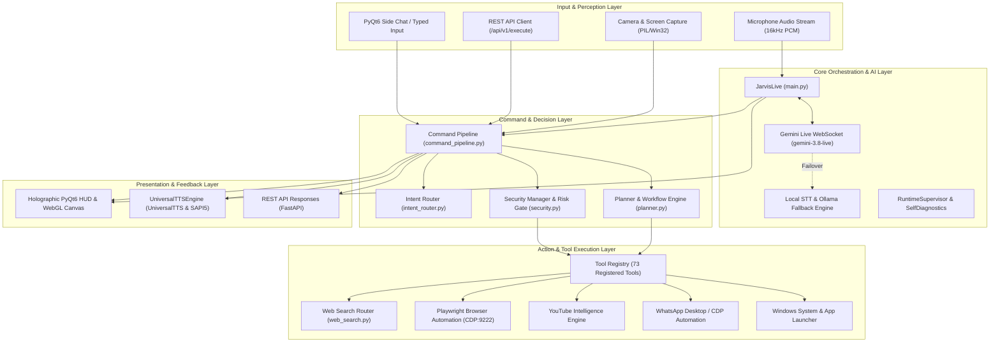
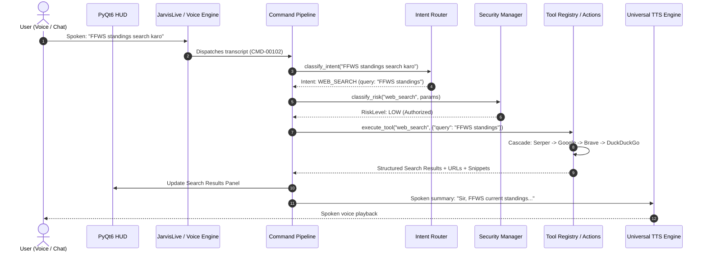

# J.A.R.V.I.S — System Architecture & Topology

> **Status:** Production Baseline Architecture  
> **Version:** 2.1.0  
> **Workspace:** `c:\Users\yajat\OneDrive\Desktop\JARVIS M\JARVIS MAIN`  
> **Verification Date:** 2026-11-06  

---

## 1. High-Level System Architecture

JARVIS is engineered as a hybrid AI executive assistant combining low-latency cloud intelligence (Gemini Live WebSocket & Gemini 2.5/3.5 models) with local offline resilience (Ollama, Faster-Whisper, and SAPI/pyttsx3). The runtime operates as a single OS process hosting a PyQt6 GUI main thread and dedicated asynchronous worker threads for audio streaming, background awareness, proactive monitoring, and command execution.

---

## 2. Component Breakdown & Responsibilities

### 2.1 Entry Point & Boot Sequence ([`main.py`](file:///c:/Users/yajat/OneDrive/Desktop/JARVIS%20M/JARVIS%20MAIN/main.py))
The main process executes 9 sequential boot steps:
1. **Health Check & Self-Test:** Validates system integrity, network connectivity, and API availability.
2. **Tool Registry Pre-Warm:** Initializes `default_tool_registry` with all 73 tools via lazy module wrappers.
3. **Web Search Cascading Engine:** Pre-warms search providers (Google, Serper, Brave, DuckDuckGo).
4. **Memory & Adaptive Intelligence:** Loads long-term facts from `memory/long_term.json` and initializes user habits.
5. **AI Brain Pre-Warm:** Warms local Ollama or validates Gemini API credentials.
6. **PyQt6 UI Startup:** Launches holographic window, WebGL 3D core canvas, and audio visualizer.
7. **Proactive Companion Engine:** Starts background environmental monitors (idle awareness, reminders, notifications).
8. **Spoken Greeting:** Announces readiness via `UniversalTTSEngine`.
9. **Gemini Live WebSocket Loop:** Spawns background asyncio thread connecting bidirectional 16kHz audio stream.

### 2.2 Voice & Conversational Runtime ([`JarvisLive` in `main.py`](file:///c:/Users/yajat/OneDrive/Desktop/JARVIS%20M/JARVIS%20MAIN/main.py#L588))
- **Live Bidirectional WebSocket:** Connects to `gemini-3.8-live` using `google-genai` SDK over WebSockets.
- **Microphone Stream:** Captures 16-bit 16kHz mono PCM chunks and pipes directly to Google cloud gateway.
- **Barge-In Handling:** Instant audio cutoff when user begins speaking while JARVIS is responding.
- **Failover to Local:** If 3 consecutive cloud connection drops occur, fails over to `faster-whisper` + local Ollama without crashing the UI.

### 2.3 Command Pipeline & Context State Machine ([`core/command_pipeline.py`](file:///c:/Users/yajat/OneDrive/Desktop/JARVIS%20M/JARVIS%20MAIN/core/command_pipeline.py))
- All inputs (voice transcripts, typed chat, REST API commands) converge on `process_user_command()`.
- Implements thread-safe atomic `CMD-XXXXX` correlation tracking.
- Maintains short-term conversational context (`last_app`, `last_contact`, `last_action`, `pending_confirmation`).
- Handles pronoun and referential follow-ups (e.g., *"usko message karo"* resolves to the active WhatsApp contact).

### 2.4 Intent Router ([`core/intent_router.py`](file:///c:/Users/yajat/OneDrive/Desktop/JARVIS%20M/JARVIS%20MAIN/core/intent_router.py))
- Evaluates 38+ priority intent classes via compiled regexes and keyword classifiers.
- Hierarchy:
  - System commands (Mute, Volume, Barge-In)
  - Power operations (Shutdown, Restart — requiring strict confirmation)
  - Messaging & Communications (WhatsApp, Discord, Telegram, Instagram)
  - Applications (Native Windows desktop apps, App-First routing)
  - Media & YouTube (Play, Summarize, Trending)
  - Web Search & Research (Triggers cascading search)
  - General conversational / Fallback to LLM (`OTHER`)

### 2.5 Security & Confirmation Gate ([`core/security.py`](file:///c:/Users/yajat/OneDrive/Desktop/JARVIS%20M/JARVIS%20MAIN/core/security.py))
- Enforces four distinct risk tiers:
  - **LOW:** Pure queries, search, time, weather, diagnostics.
  - **MEDIUM:** Launch apps, create files, read messages.
  - **HIGH:** Terminate apps, stop Windows services, delete user files, system power actions.
  - **CRITICAL:** Drive format, system path modifications (`C:\Windows`, `System32`), security software modifications.
- High and Critical actions require explicit user confirmation via voice or UI modal prompt.

### 2.6 Tool Execution Engine ([`core/tool_registry.py`](file:///c:/Users/yajat/OneDrive/Desktop/JARVIS%20M/JARVIS%20MAIN/core/tool_registry.py))
- 73 registered tools with JSON schemas.
- Lazy-loading module proxies (`core/register_tools.py`) ensure instant boot without importing all underlying libraries.
- Execution metrics tracking: latency, success/failure counts, error logs.

---

## 3. Data Flow & Subsystem Interaction

---

## 4. Concurrency & Threading Model

| Thread Name | Owner Module | Responsibilities | Safety Mechanisms |
|---|---|---|---|
| **Main GUI Thread** | `ui.py` (PyQt6 `QApplication`) | UI rendering, WebGL canvas, HUD animations, user events | Qt signals/slots; non-blocking; no heavy I/O |
| **Voice Runner Thread** | `main.py` (`_voice_thread`) | Asyncio event loop for Gemini Live WebSocket, PCM streaming | Thread-safe queues, atomic state flags (`_is_running`) |
| **Audio Playback Thread** | `core/tts_engine.py` | SAPI5 / Piper / Edge TTS playback | Queue with lock; barge-in interruption event |
| **Proactive Monitor** | `main.py` (`ProactiveEngine`) | Background polling of reminders, system vitals, unread msgs | 15s - 60s cooldowns, lock-protected shared state |
| **Tool Execution Workers** | `agent/executor.py` / `agent/workflow_engine.py` | Long-running subprocesses, browser automation, web scraping | Subprocess timeouts, isolated browser sessions |

---

## 5. Architectural Strengths & Technical Debt

### Identified Strengths:
1. **True Multi-Tier AI Hybrid:** Capable of cloud speed and local privacy/offline continuity.
2. **App-First Smart Routing:** Correctly prefers native Windows desktop apps over browser tabs.
3. **Robust Security Boundaries:** Protects against accidental system damage (`System32` deletion guard, format guard).
4. **Lazy Tool Loading:** 73 tools register in under 15ms at application launch.

### Technical Debt To Address in Subsequent Stages:
1. **Web Search Key Discrepancies:** Environment variable mismatches (`BRAVE_API_KEY` vs `BRAVE_SEARCH_API_KEY`) and Serper empty key handling.
2. **PyQt6-WebEngine Guard:** Missing fallback class definition in `ui.py` line 551 causing `NameError` on headless/minimal systems.
3. **Intent Router Ambiguity:** High-priority gaming/sports keywords without explicit search triggers get misclassified as conversational `OTHER`.
4. **Follow-up Context Relay:** When Gemini Live handles conversational turns directly, pipeline search follow-up context is occasionally dropped.
