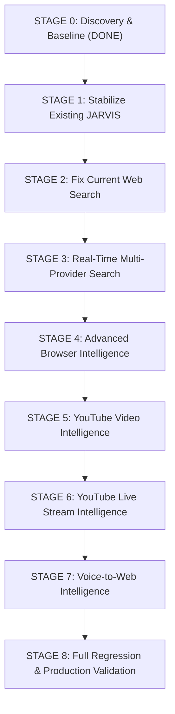

# J.A.R.V.I.S — Production Upgrade Roadmap (Stages 0 — 8)

> **Execution Policy:** Strict sequential execution. No stage begins until the previous stage passes all acceptance tests.  
> **Absolute Rule:** ZERO BREAKAGE. All 73 tools, Gemini Live, HUD, WhatsApp, and memory must remain operational throughout.  

---

## Roadmap Overview

---

## Stage Breakdown & Specifications

### STAGE 0 — DISCOVERY & BASELINE (Status: COMPLETED)
- **Objective:** Map full codebase, verify all 73 tools, test search providers, establish test baseline (999 passing tests), and generate architectural documentation without changing application code.
- **Deliverables:** `JARVIS_BASELINE.md`, `JARVIS_ARCHITECTURE.md`, `JARVIS_FEATURE_INVENTORY.md`, `JARVIS_UPGRADE_ROADMAP.md`.

---

### STAGE 1 — STABILIZE EXISTING JARVIS
- **Objective:** Fix confirmed reliability anomalies without altering public interfaces or tool signatures.
- **Target Files:**
  - [`actions/web_search.py`](file:///c:/Users/yajat/OneDrive/Desktop/JARVIS%20M/JARVIS%20MAIN/actions/web_search.py) — Resolve line 517 `UnboundLocalError` risk.
  - [`ui.py`](file:///c:/Users/yajat/OneDrive/Desktop/JARVIS%20M/JARVIS%20MAIN/ui.py) — Add fallback stub for `_ConsoleCapturePage` when `PyQt6-WebEngine` is missing.
  - [`memory/memory_manager.py`](file:///c:/Users/yajat/OneDrive/Desktop/JARVIS%20M/JARVIS%20MAIN/memory/memory_manager.py) — Eliminate race conditions in memory cache reads and disk writes.
  - [`agent/workflow_engine.py`](file:///c:/Users/yajat/OneDrive/Desktop/JARVIS%20M/JARVIS%20MAIN/agent/workflow_engine.py) — Add thread-safe reentrant lock for JSON storage.
  - [`core/tts_engine.py`](file:///c:/Users/yajat/OneDrive/Desktop/JARVIS%20M/JARVIS%20MAIN/core/tts_engine.py) — Ensure clean event-loop lifecycle and SAPI fallback cleanup.
  - [`main.py`](file:///c:/Users/yajat/OneDrive/Desktop/JARVIS%20M/JARVIS%20MAIN/main.py) — Voice runner watchdog logging and safe recovery.
  - [`actions/web_search_providers.py`](file:///c:/Users/yajat/OneDrive/Desktop/JARVIS%20M/JARVIS%20MAIN/actions/web_search_providers.py) — Normalize `BRAVE_API_KEY` / `BRAVE_SEARCH_API_KEY`.
- **Acceptance Criteria:**
  - All 73 tools remain registered and operational.
  - Fixed files pass targeted unit tests without regressions.
  - JARVIS boots cleanly and voice loop initializes.
- **Rollback Strategy:** Individual file revert via git working tree state.

---

### STAGE 2 — FIX CURRENT WEB SEARCH
- **Objective:** Diagnose provider failures, sanitize key handling, implement health monitoring, timeouts, and result normalization.
- **Target Files:**
  - [`actions/web_search_providers.py`](file:///c:/Users/yajat/OneDrive/Desktop/JARVIS%20M/JARVIS%20MAIN/actions/web_search_providers.py) — Gracefully handle empty string keys; support dual Brave key names; add per-provider timeouts (6s max) and circuit breaker.
  - [`actions/web_search.py`](file:///c:/Users/yajat/OneDrive/Desktop/JARVIS%20M/JARVIS%20MAIN/actions/web_search.py) — Standardize result payload schema: `{"title", "url", "snippet", "source", "date"}`.
  - [`actions/web_research.py`](file:///c:/Users/yajat/OneDrive/Desktop/JARVIS%20M/JARVIS%20MAIN/actions/web_research.py) — Grounded answer generation using normalized results.
- **Acceptance Criteria:**
  - Serper status changes from `AUTH_REQUIRED` to graceful skip if key is empty.
  - DuckDuckGo fallback returns rich structured snippets with verified URLs.
  - Zero unhandled exceptions or hangs on disconnected network.
  - Response time under 5s on fallback search.

---

### STAGE 3 — REAL-TIME MULTI-PROVIDER SEARCH
- **Objective:** Build an intelligent search router with relevance ranking, deduplication, freshness detection, and cricket/sports/news intelligence.
- **Target Files:**
  - `actions/web_search_router.py` (New / Refactored) — Priority ranking: configured paid API -> DuckDuckGo -> Browser CDP fallback.
  - [`actions/web_search.py`](file:///c:/Users/yajat/OneDrive/Desktop/JARVIS%20M/JARVIS%20MAIN/actions/web_search.py) — Integration with router, domain filtering, and deduplication by canonical URL.
  - [`core/intent_router.py`](file:///c:/Users/yajat/OneDrive/Desktop/JARVIS%20M/JARVIS%20MAIN/core/intent_router.py) — Expand web search trigger dictionary to include esports/tournaments ("FFWS", "standings", "rankings", "points table").
- **Acceptance Criteria:**
  - Querying "FFWS standings" returns structured tournament tables and standings with source citations.
  - Never hallucinates search data.
  - Deduplicates cross-provider results.

---

### STAGE 4 — ADVANCED BROWSER INTELLIGENCE
- **Objective:** Empower natural-language browser commands reusing existing Playwright CDP session (port 9222).
- **Target Files:**
  - [`actions/browser_automation.py`](file:///c:/Users/yajat/OneDrive/Desktop/JARVIS%20M/JARVIS%20MAIN/actions/browser_automation.py) — Add table extraction, readability text extraction, pagination handler ("next page"), and DOM accessibility tree inspection.
  - [`actions/browser_control.py`](file:///c:/Users/yajat/OneDrive/Desktop/JARVIS%20M/JARVIS%20MAIN/actions/browser_control.py) — Natural language action translation (Hindi/Hinglish supported: *"table mein rankings nikaalo"*, *"is website par TSG ki position find karo"*).
- **Acceptance Criteria:**
  - Reuses active 'Yajat' Chrome session without creating rogue browser processes.
  - Correctly extracts and formats HTML tables into markdown tables for user presentation.
  - Zero credential leakage or CAPTCHA bypass attempts.

---

### STAGE 5 — YOUTUBE VIDEO INTELLIGENCE
- **Objective:** Deep video understanding (metadata, chapters, transcripts, timestamp-based questions) without requiring paid YouTube Data API keys.
- **Target Files:**
  - [`actions/youtube_video.py`](file:///c:/Users/yajat/OneDrive/Desktop/JARVIS%20M/JARVIS%20MAIN/actions/youtube_video.py) — Extract transcripts via `youtube-transcript-api`, extract chapter markers, parse video timestamps, and synthesize answers to queries like *"10 minute ke baad kya hua tha?"*.
  - Region configuration: Ensure trending defaults to India (`IN`) or user preference.
- **Acceptance Criteria:**
  - Retrieves accurate transcripts for tournament and news videos.
  - Distinguishes between videos with transcripts vs videos with only metadata.
  - Answers specific time-indexed questions accurately with timestamp links.

---

### STAGE 6 — YOUTUBE LIVE STREAM INTELLIGENCE
- **Objective:** Real-time live stream understanding, live chat/caption extraction, and OCR scoreboard tracking for ongoing events.
- **Target Files:**
  - `actions/youtube_live.py` (New modular service) — Detects if a stream is live, captures visible scoreboard frames via CDP browser snapshot, extracts standings via OCR / Gemini Vision.
  - Clear state labeling: `[LIVE VERIFIED]`, `[LAST KNOWN UPDATE]`, `[HISTORICAL]`, or `[UNVERIFIED]`.
- **Acceptance Criteria:**
  - Accurately reports current standings from live streams without fabricating scores.
  - Falls back gracefully to official live web tables when stream video frames are inaccessible.

---

### STAGE 7 — VOICE-TO-WEB INTELLIGENCE
- **Objective:** Fix voice routing gap so search requests and search follow-ups aren't swallowed by Gemini Live conversational turns.
- **Target Files:**
  - [`main.py`](file:///c:/Users/yajat/OneDrive/Desktop/JARVIS%20M/JARVIS%20MAIN/main.py) — Update `_voice_requires_pipeline()` to intercept queries needing real-time search even when Gemini produces conversational audio.
  - [`core/command_pipeline.py`](file:///c:/Users/yajat/OneDrive/Desktop/JARVIS%20M/JARVIS%20MAIN/core/command_pipeline.py) — Multi-turn context preservation for conversational follow-ups (*"Haan haan, web par search karke bata de"* resolves to the prior turn's topic).
- **Acceptance Criteria:**
  - Spoken query *"FFWS Week 1 Day 1 standings"* triggers `web_search` and speaks structured results.
  - Follow-up *"Web par search kar"* immediately executes search for the active topic.

---

### STAGE 8 — FULL REGRESSION & PRODUCTION VALIDATION
- **Objective:** Run full test suite, verify 100% of all 73 tools, perform live end-to-end integration testing across voice, web search, browser automation, and YouTube intelligence.
- **Deliverables:** `TEST_RESULTS.md`, `FINAL_PRODUCTION_REPORT.md`.
- **Acceptance Criteria:**
  - Test suite passes with >= 1000 passing tests (improving over baseline 999).
  - All existing features (Gemini Live, HUD, WhatsApp, computer control, memory) verified working.
  - Zero broken tools.
