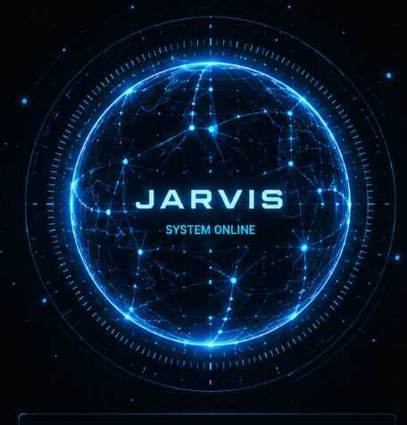
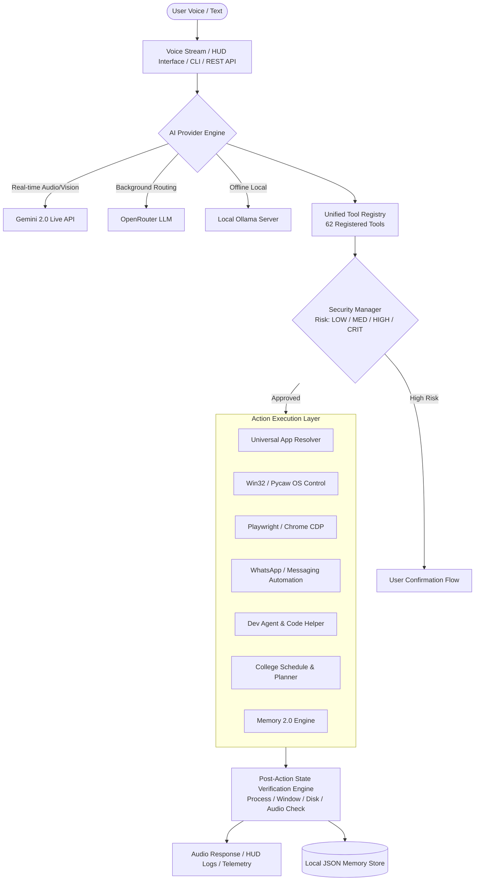

# 🤖 JARVIS AI — Autonomous Personal Assistant & Desktop Command Center

<p align="center">
  
</p>

<p align="center">
  <strong>A real-time voice, visual, and autonomous command layer engineered for Windows desktop automation, multimodal intelligence, and persistent personal workflow acceleration.</strong>
</p>

<p align="center">
  <a href="LICENSE"></a>
  
  
  
  
  
</p>

---

## 📑 Table of Contents

- [Overview](#-overview)
- [Key Capabilities & Status](#-key-capabilities--status)
- [System Architecture](#-system-architecture)
- [Repository Structure](#-repository-structure)
- [Installation & Setup](#-installation--setup)
- [Configuration](#-configuration)
- [Usage & Commands](#-usage--commands)
- [API & Python SDK](#-api--python-sdk)
- [Verification & Testing](#-verification--testing)
- [Security Model & Privacy](#-security-model--privacy)
- [Limitations](#-limitations)
- [Future Roadmap](#-future-roadmap)
- [Project Vision & Authorship](#-project-vision--authorship)
- [License](#-license)

---

## 🌟 Overview

**JARVIS AI** is an open-source, production-grade personal AI assistant and desktop command center. It bridges the gap between natural human conversation and native operating system execution. 

Unlike conventional chatbots that only output text, JARVIS combines **real-time bidirectional audio streaming** (via Google Gemini Live API) and **intelligent LLM intent routing** with a **deterministic tool execution registry**, allowing you to control applications, manage files, adjust audio/hardware settings, perform web searches, inspect screens, and automate complex desktop workflows—all while enforcing explicit safety policies and verifying actual post-action system state.

---

## ⚡ Key Capabilities & Status

Every feature in JARVIS is categorized according to its real runtime implementation:

### 🟢 Implemented & Verified (Production Ready)
- **Bidirectional Voice Streaming**: Full-duplex speech-to-speech audio loop with Gemini 2.0 Live WebSocket pipeline, real-time interruptibility, and audio hardware watchdog.
- **Universal Application Resolver**: Intelligent desktop catalog scanner discovering Win32 executables, Start Menu shortcuts, UWP modern apps, Steam/Epic games, and browser webapps with fuzzy matching.
- **Windows System & Hardware Control**: Direct volume control (Pycaw endpoint + keypress fallback), media playback, screen brightness, process management (`taskkill`, `psutil`), and multi-monitor screenshots.
- **Deterministic State Verification Engine**: Every OS command is verified post-execution (checking process lists, window handles, filesystem modifications, or audio device levels) rather than blindly assuming success.
- **Four-Tier Security Manager**: Automatic risk classification (`LOW`, `MEDIUM`, `HIGH`, `CRITICAL`) with enforced user confirmation for high-impact or destructive actions.
- **3D Holographic HUD**: Eye-comfortable PyQt6 + PyQt6-WebEngine desktop interface featuring an offline WebGL/Three.js 3D particle core, real-time audio frequency visualizer, and telemetry metrics.
- **Persistent Memory 2.0**: Structured local memory tracking user preferences, identity, active projects, routines, and custom instructions with zero cloud data leakage.
- **Web Automation & Search**: Intelligent fallback search engine (DuckDuckGo, Brave, Serper) and Playwright-powered headless/headed browser extraction.
- **Modular College Mode**: Academic schedule tracking, assignment deadline reminders, exam notifications, and note summarizer via `config/college_schedule.json`.
- **Autonomous Dev Agent & Code Helper**: Multi-file project scaffolding, script creation, single-file editing, and safe sandboxed execution.
- **Developer Platform (SDK & REST API)**: FastAPI HTTP/REST server (`jarvis_api/server.py`) and Python SDK (`jarvis_api/client.py`) with 13 functional endpoints and CLI tools.

### 🟡 Implemented & Session-Dependent (Requires Local Setup)
- **Chrome User Profile Integration**: Controls active Google Chrome tabs via Playwright CDP attachment (connects to your existing user profile).
- **Messaging Automations**: WhatsApp Web/Desktop automation, Telegram bot integration, and Discord voice/mute actions (operates through user-authorized browser or desktop sessions).

### 🔵 Experimental / Optional
- **Local Ollama AI Provider**: Complete offline fallback allowing local open-weight models (e.g., `fotiecodes/jarvis:latest`) to handle persona chats and tool generation without external internet access.
- **Opt-In Multimodal Vision**: Real-time webcam frame processing and visual screen analysis (disabled by default for privacy; activatable on-demand).

---

## 🏗️ System Architecture



---

## 📁 Repository Structure

```text
JARVIS/
├── main.py                  # Main voice assistant entry point & Gemini Live loop
├── ui.py                    # PyQt6 3D Holographic HUD desktop visualizer
├── or_client.py             # OpenRouter & Ollama LLM provider client
├── start_jarvis.bat         # Quick-start batch file for Windows
├── pyproject.toml           # Package metadata, scripts, and build dependencies
├── requirements.txt         # Core Python dependencies
├── .env.example             # Environment variables template
├── LICENSE                  # MIT Open Source License
├── CONTRIBUTING.md          # Guidelines for contributing
├── SECURITY.md              # Security policies and responsible disclosure
│
├── core/                    # Core System Infrastructure
│   ├── tool_registry.py     # Tool registry with schema validation & timeouts
│   ├── register_tools.py    # Auto-registration of all 62 system tools
│   ├── security.py          # 4-tier risk classification & confirmation logic
│   ├── verification.py      # Deterministic post-action OS state verification
│   ├── context_engine.py    # Context resolution & active workspace detector
│   ├── health_check.py      # Component diagnostics & system health auditor
│   ├── ollama_provider.py   # Offline local Ollama provider client
│   └── cli.py               # Command-line interface subcommands
│
├── actions/                 # Specialized Action Modules
│   ├── universal_app_resolver.py # Win32/UWP/Registry app resolver
│   ├── computer_settings.py # Pycaw volume, display, process manager
│   ├── computer_control.py  # Mouse, keyboard, hotkeys, screenshot capture
│   ├── browser_control.py   # Playwright web automation & extraction
│   ├── chrome_profile.py    # Google Chrome CDP profile attachment
│   ├── whatsapp_automation.py # WhatsApp Web / Desktop interaction
│   ├── dev_agent.py         # Autonomous multi-file project developer
│   ├── code_helper.py       # Code editing, inspection, and script execution
│   ├── college_mode.py      # Timetable, assignments, note summarization
│   ├── screen_processor.py  # Real-time screen capture & webcam vision
│   └── web_search.py        # Multi-provider web search fallback engine
│
├── agent/                   # Multi-Step Planning & Proactivity
│   ├── executor.py          # Compound plan executor
│   ├── planner.py           # Multi-step goal decomposition
│   ├── proactive_engine.py  # Background proactive notification watcher
│   └── task_queue.py        # Asynchronous background task scheduler
│
├── memory/                  # Persistent Adaptive Memory Layer
│   ├── memory_manager.py    # Long-term memory storage & query engine
│   ├── adaptive_intelligence.py # Workflow pattern & reflex learning
│   └── long_term.example.json   # Sanitized long-term memory template
│
├── jarvis_api/              # REST API Server & Python SDK
│   ├── server.py            # FastAPI REST application (13 endpoints)
│   ├── client.py            # Python SDK client for remote control
│   └── models.py            # Pydantic request/response schemas
│
├── assets/                  # HUD Graphics & Visual Assets
│   ├── jarvis_3d_core.html  # Offline Three.js 3D WebGL particle core
│   └── jarvis_holographic_ui.html # HUD overlay templates & styles
│
├── config/                  # Configuration Templates & Schemas
│   ├── api_keys.example.json # JSON configuration template
│   ├── college_schedule.json # Academic timetable & assignment schema
│   └── awareness.json       # Background awareness & camera defaults
│
├── docs/                    # Architectural & Subsystem Documentation
│   ├── architecture.md      # Detailed system architecture guide
│   ├── quickstart.md        # Step-by-step onboarding walkthrough
│   ├── rest-api.md          # REST API endpoint reference
│   ├── sdk.md               # Python SDK developer guide
│   └── security.md          # Security tiers and safety specifications
│
├── examples/                # Integration Examples
│   ├── sdk_example.py       # Python SDK script demonstration
│   ├── rest_example.py      # REST API client demonstration
│   ├── nodejs_example.js    # Node.js API client example
│   └── curl_examples.md     # cURL command reference
│
├── scripts/                 # Diagnostics, Profiling & Validation
│   ├── e2e_hardware_audit.py # Hardware audio/mic validator
│   └── profile_runtime_latency.py # Latency benchmark auditor
│
└── tests/                   # Test Suite
    ├── run_tests.py         # Master integration & verification runner (24 checks)
    └── regression/          # Baseline regression test suite
```

---

## 🚀 Installation & Setup

### Prerequisites
- **Operating System**: Windows 10 or 11 (Recommended for full Win32 app resolver & Pycaw support).
- **Python**: Version `3.10`, `3.11`, `3.12`, or `3.14`.
- **Audio Hardware**: Working microphone and audio output device.
- **API Keys**: Google Gemini API key (Free at [Google AI Studio](https://aistudio.google.com/)).

### Step 1: Clone the Repository
```bash
git clone https://github.com/YajatArora7518/JARVIS.git
cd JARVIS
```

### Step 2: Create a Virtual Environment
```bash
# Windows (Command Prompt / PowerShell)
python -m venv venv
.\venv\Scripts\activate

# macOS / Linux
python3 -m venv venv
source venv/bin/activate
```

### Step 3: Install Dependencies
```bash
pip install --upgrade pip
pip install -r requirements.txt
playwright install chromium
```

### Step 4: Configure Environment Variables
Copy `.env.example` to `.env` and enter your API keys:
```bash
cp .env.example .env
```
Edit `.env`:
```env
GEMINI_API_KEY=your_actual_gemini_api_key
OPENROUTER_API_KEY=your_optional_openrouter_key
GEMINI_MODEL=gemini-2.0-flash
OS_SYSTEM=windows
```

Alternatively, copy `config/api_keys.example.json` to `config/api_keys.json`.

---

## ⚙️ Configuration

| Environment Variable | Description | Default | Required |
|---|---|---|---|
| `GEMINI_API_KEY` | Google Gemini API key for Live audio/vision streaming | *None* | **Yes** (for live voice) |
| `OPENROUTER_API_KEY` | OpenRouter API key for background LLM routing | *None* | Optional |
| `GEMINI_MODEL` | Gemini model name | `gemini-2.0-flash` | Optional |
| `OS_SYSTEM` | Target operating system (`windows`, `mac`, `linux`) | `windows` | Optional |
| `OLLAMA_ENABLED` | Enable local offline Ollama inference | `false` | Optional |
| `OLLAMA_BASE_URL` | Local Ollama endpoint | `http://localhost:11434` | Optional |
| `JARVIS_HOST` | REST API binding host | `127.0.0.1` | Optional |
| `JARVIS_PORT` | REST API binding port | `8000` | Optional |

---

## 🎤 Usage & Commands

### 1. Launch Main Voice Assistant & 3D HUD
```bash
python main.py
```
*JARVIS will initialize all 62 tools, run hardware self-checks, launch the 3D HUD, and start listening on your microphone.*

### 2. Launch Safe Demo Mode
```bash
python main.py --demo
```
*Runs an interactive walkthrough demonstrating speech synthesis, HUD animation, tool dispatch, and verification without executing modifying actions.*

### 3. Launch REST API Server
```bash
python -m jarvis_api.server
# Or using the registered CLI shortcut:
jarvis-api
```
*API documentation will be accessible live at `http://127.0.0.1:8000/docs`.*

### Example Real Voice / Text Commands
- **Application Control**:
  - *"JARVIS, open Google Chrome"*
  - *"Launch Visual Studio Code"*
  - *"Close Notepad"*
- **System & Volume**:
  - *"Set master volume to 50 percent"*
  - *"Mute system volume"*
  - *"Take a screenshot"*
  - *"What is my current CPU and RAM usage?"*
- **Information & Web**:
  - *"Search the web for latest space exploration news"*
  - *"What is the weather today?"*
- **College Mode**:
  - *"What is my schedule for Monday?"*
  - *"What assignments are due this week?"*
  - *"Summarize this lecture note"*
- **Memory Engine**:
  - *"Remember that my favorite programming language is Python"*
  - *"What do you remember about my preferences?"*
  - *"Forget my old project note"*

---

## 🔌 API & Python SDK

JARVIS includes a built-in Python SDK and REST API for programmatic automation and external application integration.

```python
from jarvis_api.client import JarvisClient

client = JarvisClient(base_url="http://127.0.0.1:8000")

# Check system health
health = client.get_status()
print(f"Status: {health['status']} | Tools: {health['tools_count']}")

# Execute an action
result = client.call_tool("open_app", {"app_name": "notepad"})
print(f"App Launch Verified: {result.verified}")

# Query long-term memory
prefs = client.get_memory("preferences")
print(f"User Preferences: {prefs}")
```

---

## 🧪 Verification & Testing

JARVIS includes a master verification test suite that executes integration checks across all 24 subsystems:

```bash
# Run Master Integration & System Verification Test Suite
python tests/run_tests.py

# Run Baseline Regression Test Suite
python -m unittest tests/regression/test_baseline_regression.py
```

### Verified Subsystem Checklist
- [x] **Core Architecture Pipeline**: 62 tools registered and validated.
- [x] **Tool Registry**: Dynamic dispatch, argument schema validation, timeout guards.
- [x] **Security Engine**: 4-tier risk classification (`LOW`/`MED`/`HIGH`/`CRIT`).
- [x] **Windows Automation**: Process launching, window handle detection, clean termination.
- [x] **Application Volume Control**: Pycaw mixer and keypress fallbacks.
- [x] **Filesystem Agent**: Path validation, sandboxed file operations.
- [x] **Browser Agent**: Playwright browser automation and CDP integration.
- [x] **System Telemetry**: Real-time CPU, RAM, Disk, and Battery diagnostics.
- [x] **Memory 2.0 Engine**: Persistent store, retrieval, and fallback mechanisms.
- [x] **REST API & SDK**: 13 FastAPI endpoints and client wrappers verified.

---

## 🛡️ Security Model & Privacy

### Operating Boundaries & Permissions
- **User Privilege Scope**: JARVIS operates strictly under the operating system user permissions of the user running it. It does not perform privilege escalation without explicit Windows UAC confirmation.
- **Explicit Confirmation**: Destructive or high-impact actions (e.g. system shutdown, service modification, script execution, voice/video calls) require explicit verbal or UI confirmation.
- **Deterministic Verification**: Every action is cross-checked against actual OS state before reporting success to prevent hallucinated actions.

### Privacy & Data Isolation
- **Zero Cloud Leakage**: Long-term memory, conversation history, user preferences, and private contacts are stored strictly in local JSON files on your machine.
- **Opt-In Vision**: Camera capture and screen analysis are disabled by default. When active, an unmistakable indicator is rendered on the HUD.

---

## ⚠️ Limitations

1. **Operating System Focus**: While core tool interfaces and REST APIs are cross-platform, native desktop application resolution, window focus manipulation, and Pycaw audio mixer features are optimized primarily for **Windows 10 and 11**.
2. **Third-Party Sessions**: Automations for platforms like WhatsApp Web, Discord, and Telegram rely on active, user-authenticated local sessions and standard DOM/window availability.
3. **Network Requirements**: Real-time Gemini Live voice streaming requires active internet connectivity. For offline environments, local Ollama mode can be utilized.

---

## 🗺️ Future Roadmap

- [ ] **Cross-Platform Parity**: Extended native application resolver and volume mixer for macOS (CoreAudio) and Linux (PulseAudio/ALSA).
- [ ] **Voice Biometrics**: Speaker identification to restrict high-risk voice commands to authorized users.
- [ ] **Multi-Agent Orchestration**: Specialized parallel sub-agents for concurrent long-running developer tasks.
- [ ] **Mobile Companion Relay**: Secure local network bridge for Android/iOS mobile companion app.

---

## 💡 Project Vision & Authorship

**JARVIS was conceived, designed, and directed by Yajat Arora.**

The original ideas, feature concepts, product vision, functionality goals, system architecture requirements, and overall direction of the project originate from the creator of this project.

The implementation process was heavily assisted by modern AI coding and development systems. Much of the codebase was generated, accelerated, debugged, tested, or refined with the assistance of AI development tools operating under the creator's direct guidance and iterative review.

The project should therefore be understood as an **AI-assisted software engineering project**: the human creator defined the vision, requirements, architecture direction, feature sets, security boundaries, and iterative decisions, while AI development systems played a significant role in implementation and code acceleration.

---

## 📄 License

This project is licensed under the **MIT License** — see the [LICENSE](LICENSE) file for details.

```text
Copyright (c) 2026 Yajat Arora
```
